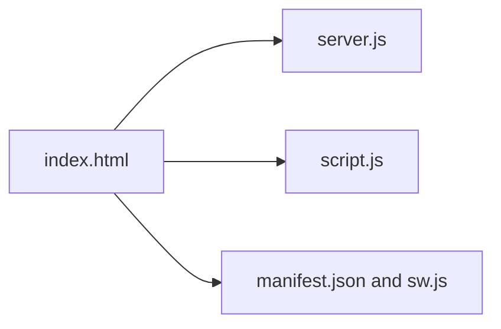

# Security Protocols

## Overview

Security Protocols is a small browser/PWA prototype with a Node.js server and a security-audit themed interface. The repository contains a web entry page, client scripts, icons, manifest metadata, and service-worker support.

## Architecture



## Project structure

- `server.js` — Node.js server entry point.
- `index.html`, `ayu.html` — browser pages.
- `script.js` — client-side behavior.
- `manifest.json`, `sw.js`, `icon-*.png` — PWA assets.

## Run locally

```bash
npm install
npm start
```

Keep deployment credentials and private configuration in environment variables.

## Status

Prototype interface; no automated test command or release process is declared.

## License

No license is currently declared.
